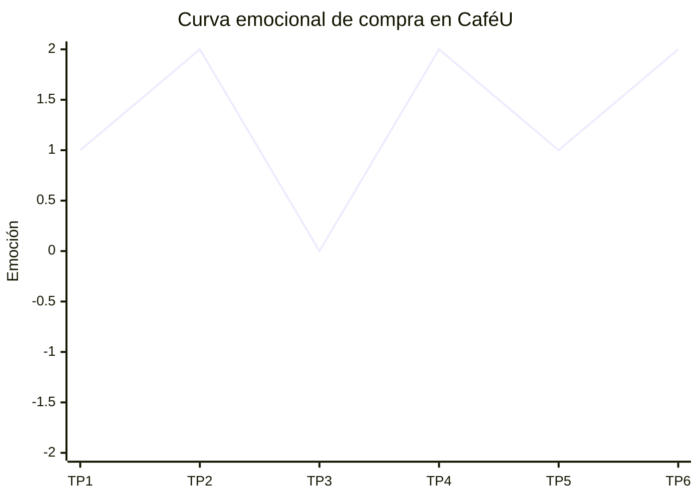

# Análisis de usuario y experiencia

## Persona usuaria

| Campo | Detalle |
|---|---|
| Nombre | Mateo Villacís |
| Edad / carrera / semestre | 21 años · Ingeniería en Software · 5.º semestre (UTA-FISEI) |
| Dispositivo y conexión | Smartphone Android de gama media (viewport de 360 px), datos móviles 4G o Wi-Fi universitario intermitente |
| Objetivo al usar CaféU | Consultar productos disponibles, armar su pedido en menos de un minuto y obtener el número de orden para pagar y retirar rápido en caja |
| Frustraciones actuales | Perder minutos de receso haciendo fila sin saber qué está agotado; equivocarse al pulsar botones pequeños con una mano; borrar un ítem por accidente sin poder recuperarlo; mensajes de error poco claros |
| Nivel de experiencia con apps de pedidos | Medio-alto (usa apps de comida rápida y banca móvil a diario; valora flujos directos sin registro previo) |

Mateo cursa materias seguidas en el bloque de FISEI y suele tener apenas 10 minutos entre una clase y la siguiente para comer algo antes de entrar a laboratorio. Usa CaféU 2.0 desde su teléfono mientras camina hacia la cafetería para decidir su compra con anticipación, verificar el total exacto que va a pagar y llegar al mostrador únicamente a mostrar su código de pedido.

## Contexto de interacción

Mateo interactúa con la aplicación de pie, caminando por los pasillos o esperando en la fila de la cafetería universitaria. Dispone de muy poco tiempo (10 minutos entre clases), suele sostener el celular con una sola mano usando el pulgar en la zona inferior de la pantalla, en un entorno con ruido constante de conversaciones, movimiento y luz natural que puede generar reflejos. La conexión Wi-Fi del campus puede fluctuar, por lo que necesita respuestas rápidas en pantalla y que su carrito no se pierda si la página se recarga.

## Touchpoints

| N.º | Touchpoint | Canal | Qué hace el usuario | Qué necesita ver |
|---|---|---|---|---|
| TP1 | Abrir la app y explorar el catálogo | App | Ingresa a CaféU 2.0 y revisa categorías disponibles sin iniciar sesión | Lista clara de productos con categoría, descripción, precio y etiqueta visible en productos `Agotado` |
| TP2 | Buscar y agregar productos | App | Escribe en el buscador (p. ej. `cafe leche` o `sanduche`) o filtra por categoría y pulsa `Agregar` | Resultados inmediatos sin importar tildes ni mayúsculas, cantidad agregada en la tarjeta y aviso de confirmación con total |
| TP3 | Revisar carrito y ajustar cantidades | App | Toca `Ver pedido` en la barra inferior móvil, ajusta cantidades con `−` / `+` o escritura directa, o corrige/elimina ítems | Controles táctiles cómodos, subtotal por línea, total actualizado y opción `Deshacer` si elimina o cancela por error |
| TP4 | Revisar resumen y confirmar pedido | App | Pulsa `Revisar y confirmar pedido`, verifica ítems y total en el diálogo modal y confirma | Diálogo `Revisa tu pedido` con opción `Volver y editar` y, al confirmar, pantalla `Pedido confirmado` con código `CU-...` |
| TP5 | Mostrar número y pagar en caja | Caja / mostrador | Muestra su pantalla con el código `CU-...` y cancela el monto indicado | Código legible en fuente monoespaciada y total final coincidente con el resumen |
| TP6 | Retirar el pedido | Caja / mostrador | Escucha o verifica su número de orden y recibe los productos | Entrega ágil que coincida con las cantidades y productos del resumen confirmado |

## Momentos de verdad

| Momento | Touchpoint | Por qué es crítico | Cómo responde la app |
|---|---|---|---|
| MV1 | TP2 · Búsqueda y disponibilidad | Si el estudiante busca rápido sin tildes o intenta pedir algo agotado y no recibe una respuesta clara e inmediata, asume que no hay producto o que el sistema falló y abandona el flujo | Normaliza tildes y mayúsculas (`normalizarTexto`) aceptando palabras en cualquier orden con debounce de 200 ms; muestra conteo de resultados o sugerencia si no hay coincidencias; marca `Agotado` sin botón `Agregar` y anuncia el agregado en un aviso `aria-live` con el total |
| MV2 | TP3–TP4 · Control de cambios y confirmación | Al ajustar cantidades con prisa, borrar algo por error o revisar cuánto va a pagar, cualquier pérdida de información o error críptico genera desconfianza | Valida cantidades enteras entre 1 y 20 mostrando el error junto al campo y restaurando el valor válido previo; ofrece `Deshacer` durante 10 segundos tras eliminar o cancelar; persiste en `localStorage` (`cafeu:carrito`) y presenta el diálogo `Revisa tu pedido` antes de confirmar |

## Curva emocional

Escala de -2 (muy negativo) a +2 (muy positivo).

| Touchpoint | Emoción (-2 a +2) | Pensamiento del usuario |
|---|---|---|
| TP1 | +1 | "Entro directo sin crear cuenta, veo precios claros y qué está agotado." |
| TP2 | +2 | "Busqué 'cafe leche' sin tilde, lo encontró al instante y ya veo cuánto llevo." |
| TP3 | 0 | "Ajusto cantidades con una mano; si borro algo tengo Deshacer, aunque debo cuidar el rango de 1 a 20." |
| TP4 | +2 | "El resumen final me da seguridad antes de confirmar y ya tengo mi código." |
| TP5 | +1 | "Solo enseño el código en caja sin tener que dictar el pedido con todo el ruido." |
| TP6 | +2 | "Retiro exactamente lo que pedí y llego a tiempo a mi clase." |

## Matriz de problemas

| ID | Problema observado | Heurística de Nielsen | Principio de Gestalt | Cómo lo atiende la v1 |
|---|---|---|---|---|
| PR1 | Mensajes poco visibles | H1 · Visibilidad del estado del sistema | Figura-fondo y Proximidad | Región `role="status"` (`aria-live="polite"`) en `Avisos.js` fija en pantalla con colores semánticos (`exito`, `error`, `aviso`), botón de cierre de 44×44 px y pausa al enfocar o pasar el cursor; además de insignia en cabecera, barra inferior móvil y texto `En tu pedido: N` en cada tarjeta. |
| PR2 | Selección de cantidades | H4 · Consistencia y estándares · H7 · Flexibilidad y eficiencia de uso | Proximidad y Región común | `SelectorCantidad.js` agrupa `−`, campo numérico (`inputmode="numeric"`, rango 1–20) y `+` con botones de al menos 44×44 px; deshabilita `−` en 1 y `+` en 20 y permite tanto toques rápidos como escritura directa. |
| PR3 | Búsqueda de productos | H2 · Relación entre el sistema y el mundo real · H7 · Flexibilidad y eficiencia | Similitud y Proximidad | `texto.js` (`normalizarTexto`) quita tildes (NFD) y mayúsculas y evalúa todas las palabras en cualquier orden sobre nombre, descripción y categoría (`cafe leche` / `leche cafe`, `sanduche`), complementado con chips de categorías y botón `Limpiar`. |
| PR4 | Eliminación accidental | H3 · Control y libertad del usuario · H5 · Prevención de errores | Continuidad y Cierre | `EliminarDelCarrito` y `CancelarPedido` guardan el estado anterior (incluyendo posición de la línea) y muestran un aviso durante 10 s con la acción `Deshacer`; además, el diálogo modal `Revisa tu pedido` evita confirmar la orden por accidente. |
| PR5 | Recuperación de errores | H9 · Ayudar a reconocer, diagnosticar y recuperarse de errores | Proximidad y Figura-fondo | Los errores de dominio indican qué ocurrió y cómo corregirlo (`La cantidad debe estar entre 1 y 20.`, `La cantidad debe ser un número entero.`), se muestran junto al campo con `aria-invalid="true"` y restauran el último valor válido; ante búsqueda sin resultados sugiere revisar la palabra o elegir `Todas`. |
