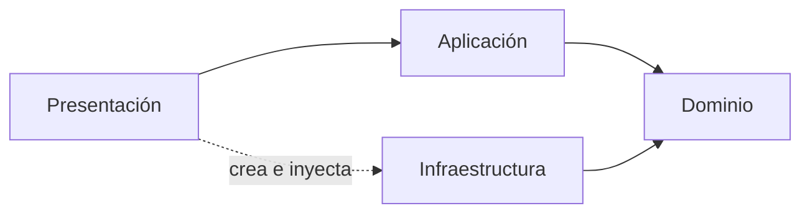
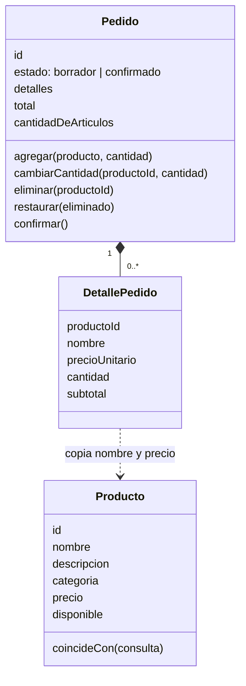

# Arquitectura de CaféU 2.0

La aplicación está hecha con HTML, CSS y JavaScript (módulos ES) sin frameworks ni dependencias. Se eligió así para que cualquier integrante pueda ejecutarla con Node y un navegador, sin instalar nada más.

El código está separado en cuatro capas. Cada carpeta de `src/` es una capa.

```
src/
├── presentation/    Pantalla, componentes, accesibilidad, eventos del usuario
│   ├── index.html
│   ├── styles.css
│   ├── main.js              composition root + controlador de la pantalla
│   └── components/          TarjetaProducto, SelectorCantidad, Carrito, Avisos, formato
├── application/     Casos de uso
│   └── casosDeUso.js        BuscarProductos, AgregarAlCarrito, CambiarCantidad,
│                            EliminarDelCarrito (con deshacer), ConfirmarPedido, ObtenerCarrito
├── domain/          Entidades y reglas de negocio
│   ├── Producto.js
│   ├── Pedido.js            agregado raíz (el carrito es un Pedido en estado borrador)
│   ├── DetallePedido.js
│   ├── texto.js             normalización para la búsqueda
│   └── errores.js
└── infrastructure/  Persistencia
    ├── almacenamiento.js    LocalStorage y versión en memoria (misma interfaz)
    ├── repositorios.js      RepositorioProductosLocal, RepositorioPedidos
    └── data/productos.js    catálogo semilla
```

## Dirección de las dependencias



- **Dominio** no importa nada de las otras capas. Tiene las reglas: la cantidad va de 1 a 20, un producto agotado no se agrega, un pedido vacío no se confirma, un pedido confirmado ya no cambia, el total se redondea a centavos.
- **Aplicación** usa el dominio y recibe los repositorios por constructor. No sabe si los datos vienen de LocalStorage o de una API; solo llama a `listar()`, `buscarPorId()`, `obtenerCarrito()`, `guardarCarrito()`, etc.
- **Infraestructura** implementa esos repositorios. Depende del dominio porque convierte objetos guardados en `Pedido` y `Producto`.
- **Presentación** solo llama a casos de uso y pinta el resultado. `main.js` es el único lugar donde se crean los repositorios y se pasan a la aplicación (composition root). Para pasar a una API REST basta con escribir un `RepositorioProductosHttp` con los mismos métodos y cambiar una línea en `main.js`.

Esta separación permite probar dominio y aplicación en Node sin navegador: las pruebas usan `AlmacenamientoEnMemoria` en lugar de LocalStorage.

## Modelo de dominio



`Pedido` es inmutable: cada operación devuelve un pedido nuevo. Así el caso de uso de eliminar puede guardar la línea quitada y su posición, y `restaurar()` la devuelve al mismo lugar (deshacer).

`DetallePedido` guarda una copia del nombre y del precio. Si después cambia el catálogo, un pedido confirmado mantiene los valores con los que se pidió.

## Búsqueda tolerante a tildes y mayúsculas

`normalizarTexto()` descompone el texto en Unicode (NFD), quita las marcas diacríticas, pasa a minúsculas y une espacios. Se aplica a la consulta y al texto del producto (nombre + descripción + categoría). Un producto coincide si contiene todas las palabras de la consulta, en cualquier orden. Ejemplos: `CAFE`, `café`, `cafe leche` y `leche cafe` encuentran "Café con leche"; `sanduche` encuentra "Sánduche mixto".

## Persistencia

| Clave en LocalStorage | Contenido |
|---|---|
| `cafeu:carrito` | Pedido en borrador (sobrevive a recargar la página) |
| `cafeu:pedidos` | Últimos 20 pedidos confirmados |

Si el navegador bloquea LocalStorage (modo privado estricto), `crearAlmacenamiento()` usa la versión en memoria y la app sigue funcionando durante la sesión. Si el carrito guardado está dañado, se descarta y se empieza con uno vacío.

## Decisiones de interfaz y accesibilidad

| Decisión | Dónde | Problema del caso que atiende |
|---|---|---|
| Mobile First: estilos base para 360 px; `min-width: 600px` y `960px` amplían | `styles.css` | Uso desde el celular en la fila |
| HTML semántico: `header`, `main`, `section` con `aria-labelledby`, `form role="search"`, `fieldset/legend`, `dl` para totales, `dialog` | `index.html`, componentes | Navegación con lector de pantalla |
| Enlaces "Saltar al catálogo / al carrito" | `index.html` | Navegación por teclado |
| Foco visible de 3 px en todos los controles (`:focus-visible`) | `styles.css` | Navegación por teclado |
| Zonas táctiles de 44 × 44 px como mínimo | `styles.css` | Selección de cantidades en móvil |
| Región `role="status"` / `aria-live` para avisos | `Avisos.js` | Visibilidad de mensajes |
| Selector de cantidad − / campo / +, con límites y error junto al campo | `SelectorCantidad.js` | Selección de cantidades, recuperación de errores |
| Eliminar sin confirmación previa pero con **Deshacer** durante 10 s | `main.js`, `EliminarDelCarrito` | Eliminación accidental |
| Diálogo "Revisa tu pedido" antes de confirmar | `main.js` | Confirmación de pedido |
| Mensajes de error que dicen qué pasó y cómo seguir | `domain/*` | Recuperación de errores |
| Foco gestionado: después de agregar vuelve al botón; después de eliminar pasa a la línea siguiente; al confirmar va al título "Pedido confirmado" | `main.js` | Orientación del usuario |

## Cómo extender

- **Nueva regla de negocio:** va en `domain/` con su prueba en `tests/pruebas-automatizadas/`.
- **Nueva acción del usuario:** caso de uso en `application/casosDeUso.js` y registro en `crearCasosDeUso()`.
- **Nuevo componente visual:** función en `presentation/components/` que recibe datos y callbacks y devuelve un nodo DOM. No debe llamar a repositorios.
