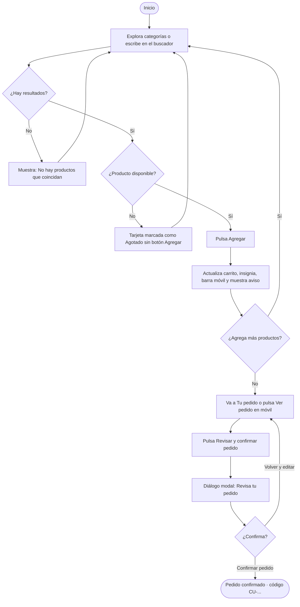
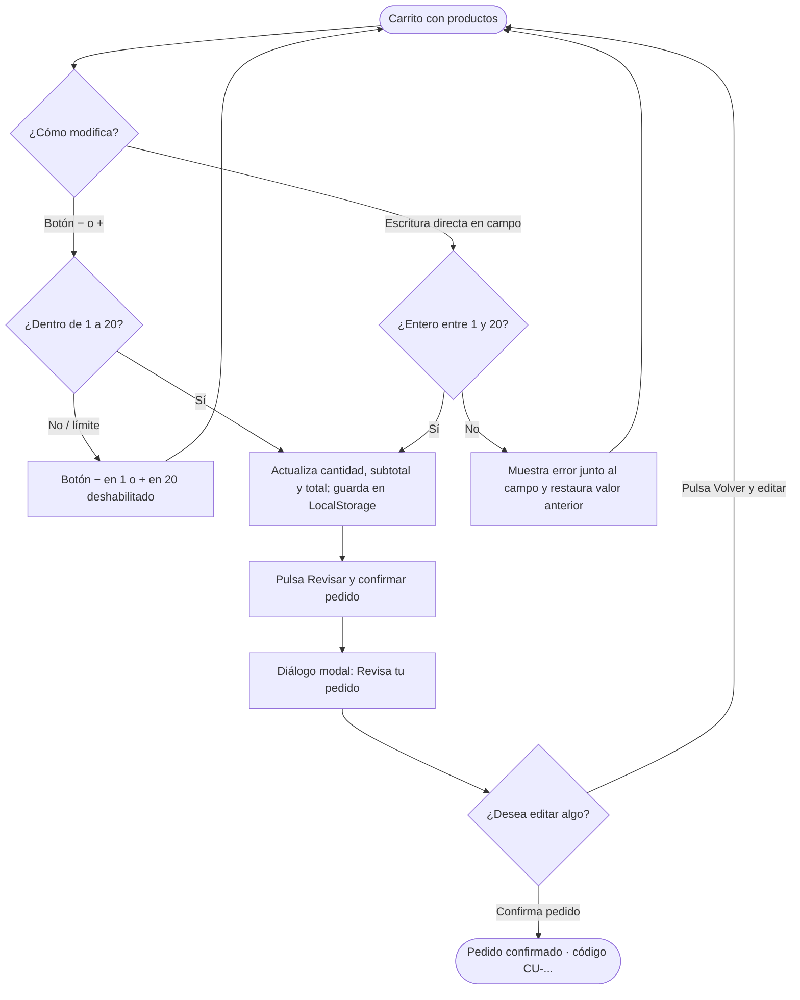
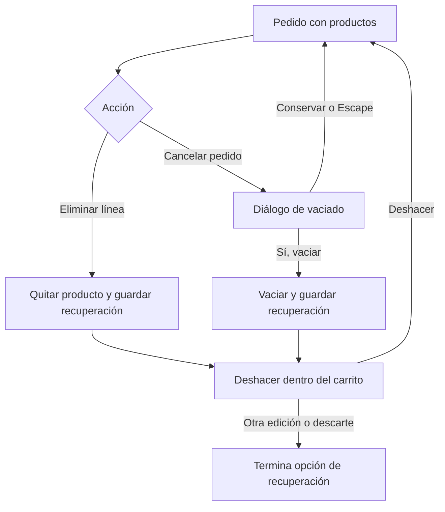

# User flows

## 1. Compra

## 2. Modificación

## 3. Eliminación y cancelación

Sin vencimiento por segundos: la opción termina al modificar o confirmar el pedido, recargar o descartarla. Los errores de persistencia interrumpen la acción y mantienen el estado anterior; se informa cómo reintentar. La revisión de confirmación se procesa después de los cambios de cantidad en cola.
