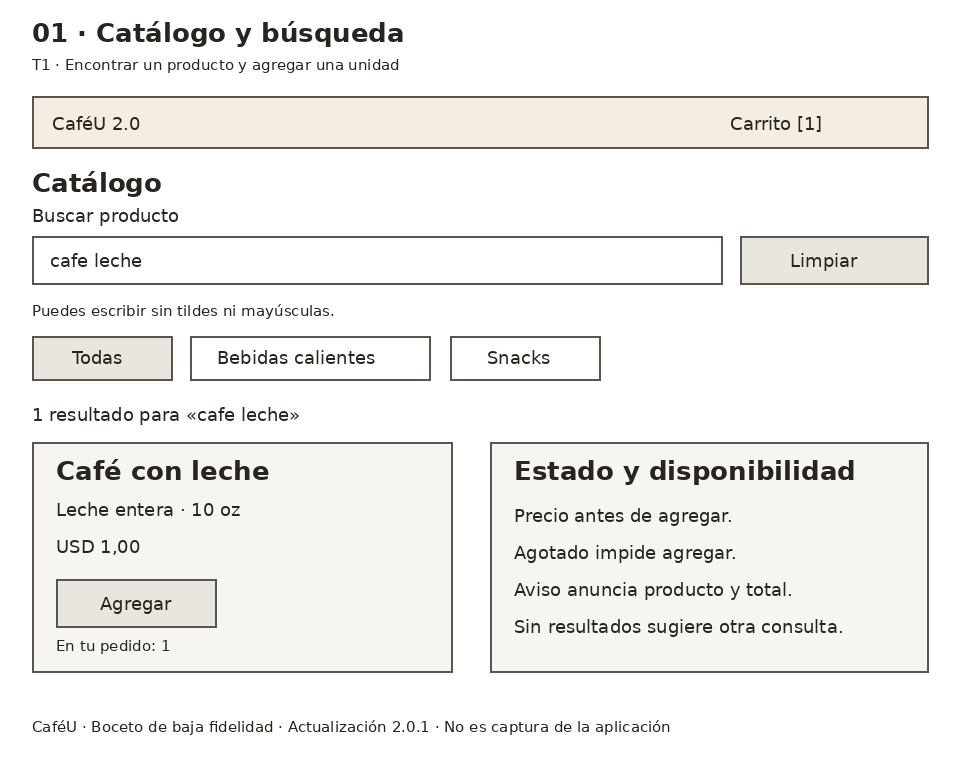
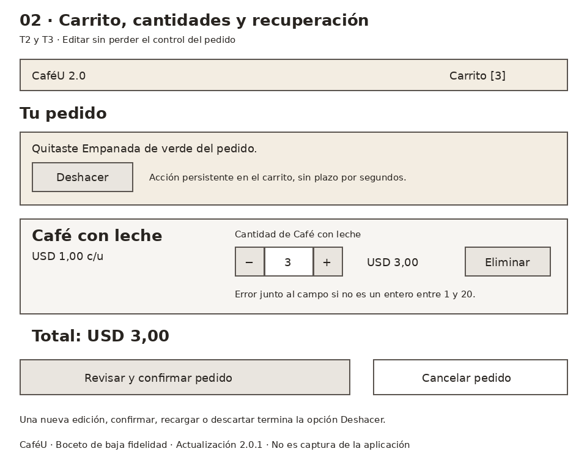
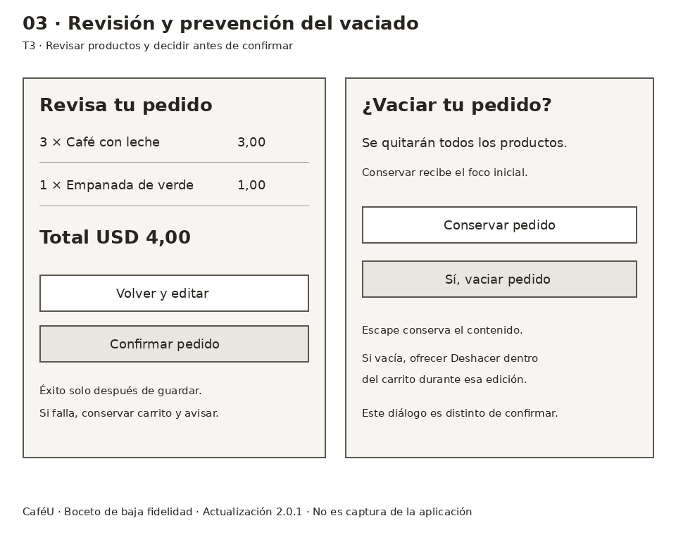

# Tres wireframes de baja fidelidad

| Boceto | Flujo y elementos | Trazabilidad |
|---|---|---|
| [01 Catálogo](01-catalogo.svg) | Búsqueda, categorías, disponibilidad, precio y Agregar | RF01–RF03, T1 |
| [02 Carrito](02-carrito.svg) | Cantidad, total, eliminación, Deshacer y error | RF04–RF05, T2–T3 |
| [03 Revisión](03-revision.svg) | Resumen, volver/confirmar y prevención del vaciado | RF05–RF06, T3 |

Son bocetos elaborados para completar la documentación de esta actualización a partir de requisitos y del código. No se presentan como diseños fechados antes de la implementación ni como capturas de sesiones. Las imágenes de la aplicación base están en `../version-v1/`.

## Vistas de los bocetos

